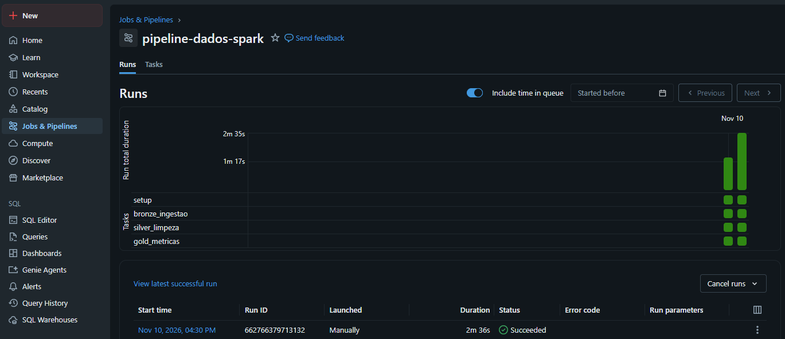
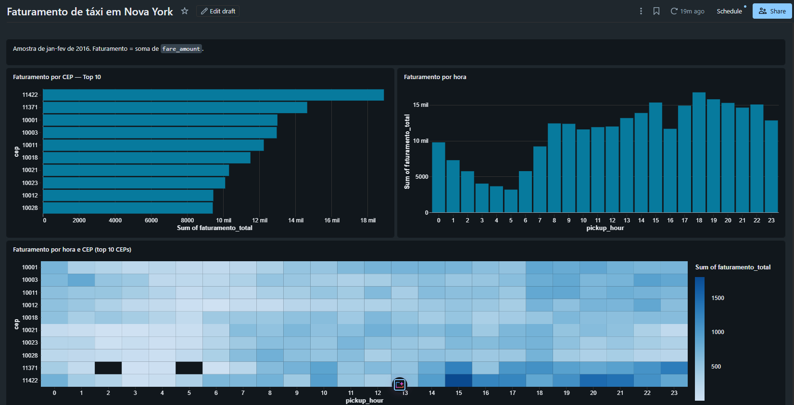

# 🥉🥈🥇 Pipeline de Dados com Spark e Databricks

Pipeline de dados em camadas (arquitetura medallion) com Spark no Databricks, processando corridas de táxi de Nova York até tabelas Delta prontas para análise, com orquestração em job e dashboard.

## Perguntas de negócio

1. Qual o faturamento por hora do dia?
2. Quais CEPs de embarque concentram mais faturamento?
3. Como horário e região se combinam? Onde e quando está o pico?

## Arquitetura

| Camada | Função |
|---|---|
| 🥉 **Bronze** | Ingestão dos dados brutos, sem alterações, em tabela Delta |
| 🥈 **Silver** | Limpeza, padronização e colunas derivadas (duração da corrida, hora do dia) |
| 🥇 **Gold** | Métricas agregadas para responder às perguntas de negócio |

Cada camada vive em um schema próprio no Unity Catalog:

| Schema | Camada |
|---|---|
| `nyctaxi_bronze` | Bronze |
| `nyctaxi_silver` | Silver |
| `nyctaxi_gold` | Gold |

## Estrutura

```
pipeline-dados-spark/
├── README.md
├── .gitignore
├── docs/
│   └── images/
│       ├── dashboard.png
│       └── execucao_job.png
└── notebooks/
    ├── 00_setup.py
    ├── 01_bronze_ingestao.py
    ├── 02_silver_limpeza.py
    └── 03_gold_metricas.py
```

## 🛠️ Tecnologias


## 🗺️ Roadmap

- [x] **Fase 0:** repositório, integração Databricks + GitHub, schemas e validação do ambiente
- [x] **Fase 1:** camada bronze (ingestão)
- [x] **Fase 2:** camada silver (limpeza e padronização)
- [x] **Fase 3:** camada gold (métricas de negócio)
- [x] **Fase 4:** orquestração, dashboard e conclusões

## Fonte dos dados

Tabela de exemplo `samples.nyctaxi.trips`, disponível no próprio Databricks. Contém corridas de táxi de Nova York de janeiro e fevereiro de 2016, com horário de embarque e desembarque, distância, tarifa e CEP de origem e destino.

## Orquestração

Os quatro notebooks rodam encadeados em um job do Databricks, em compute serverless: `setup`, `bronze_ingestao`, `silver_limpeza` e `gold_metricas`. Cada tarefa só começa depois que a anterior termina com sucesso.



## Dashboard



As células escuras do mapa de calor são combinações de hora e CEP sem nenhuma corrida na amostra.

## Resultados

Os resultados abaixo valem para esta amostra (jan-fev de 2016) e usam faturamento como a soma de `fare_amount`.

### Faturamento por hora

As cinco horas de maior faturamento ficam entre 15h e 22h e somam 29,2% do total.

| Hora | Corridas | Faturamento (US$) | % do total |
|---|---|---|---|
| 18h | 1.446 | 16.754,50 | 6,25% |
| 19h | 1.391 | 15.786,50 | 5,89% |
| 15h | 1.167 | 15.334,01 | 5,72% |
| 20h | 1.244 | 15.280,00 | 5,70% |
| 22h | 1.183 | 15.059,00 | 5,62% |

As madrugadas de 4h e 5h têm o maior ticket médio (cerca de US$ 14,70), mas pouco volume, e respondem por apenas 1,2% a 1,4% do faturamento.

### Faturamento por CEP de embarque

| CEP | Corridas | Faturamento (US$) | Ticket médio (US$) | % do total |
|---|---|---|---|---|
| 11422 | 418 | 18.901,50 | 45,22 | 7,05% |
| 11371 | 479 | 14.650,00 | 30,58 | 5,46% |
| 10001 | 1.224 | 13.000,01 | 10,62 | 4,85% |
| 10003 | 1.180 | 12.963,00 | 10,99 | 4,84% |
| 10011 | 1.126 | 12.244,50 | 10,87 | 4,57% |

Os dois primeiros CEPs somam 12,5% do faturamento com cerca de 4% das corridas, por causa do ticket médio alto e da distância média (15,8 milhas no primeiro). A causa não aparece nos dados. A hipótese é deslocamento de ou para aeroportos, não verificada. Os CEPs de Manhattan têm muitas corridas curtas e ticket de cerca de US$ 11.

### Hora e CEP combinados

Os dois CEPs de ticket alto lideram o faturamento em 16 das 24 horas. Manhattan lidera nas outras 8 (1h a 4h, 8h e 11h a 13h), horários de mais volume e corridas curtas.

Em horários de pouco volume o líder é frágil: às 5h, por exemplo, o CEP líder tem apenas 8 corridas.

## Como reproduzir

1. Crie uma conta gratuita no Databricks Free Edition.
2. Em Settings → Linked accounts, conecte o GitHub com um token pessoal.
3. Crie uma Git folder apontando para este repositório.
4. Crie um job com quatro tarefas de notebook, nesta ordem: `00_setup`, `01_bronze_ingestao`, `02_silver_limpeza` e `03_gold_metricas`, cada uma dependendo da anterior.
5. Execute o job e crie o dashboard sobre as tabelas do schema `nyctaxi_gold`.

## Limitações

- A base tem cerca de 22 mil corridas de dois meses de 2016, então os resultados descrevem esta amostra, e não a cidade.
- Faturamento considera apenas a tarifa (`fare_amount`), sem gorjetas nem taxas.
- A região é o CEP de embarque, sem nome de bairro.
- O Free Edition permite compartilhar dashboards publicados apenas com usuários da própria conta Databricks, por isso o dashboard está documentado em imagem.

## Registro das decisões

### Fase 0

- **Notebooks em formato source (`.py`) dentro de uma Git folder:** o diff no GitHub fica legível e o histórico por fase fica limpo.
- **Um schema por camada:** separa responsabilidades e facilita permissões e leitura das tabelas.
- **Pasta `notebooks/` na raiz do repositório:** mantém a raiz limpa e deixa espaço para documentação e imagens.
- **Fonte única, a tabela de exemplo do Databricks:** o foco do projeto é a arquitetura em camadas e a análise, sem depender de download ou upload de arquivos. O projeto fica reprodutível por qualquer pessoa com uma conta gratuita.
- **Faturamento = soma de `fare_amount`:** a base não tem gorjeta nem taxas, então faturamento aqui é a tarifa das corridas.
- **Região = CEP de embarque (`pickup_zip`):** a base não traz nome de bairro nem de zona.

### Fase 1

- **Colunas de controle na bronze (`_source_table`, `_ingested_at`):** rastreabilidade da origem sem alterar os dados brutos.
- **Carga com `overwrite`:** a execução é idempotente, e reprocessar não duplica dados.

### Fase 2

- **Limpeza orientada por regras nomeadas:** cada regra é medida isoladamente antes do descarte e registrada na tabela `quality_log`.
- **`dropoff_zip` nulo não descarta a linha:** as perguntas de negócio usam apenas o CEP de embarque.
- **Colunas derivadas na silver:** `pickup_date`, `pickup_hour`, `pickup_dayofweek` e `trip_duration_min`, prontas para as agregações da gold.
- **Log de qualidade com `append`:** cada execução adiciona seus resultados com a data, preservando o histórico das versões da limpeza.
- **Regras de outliers de duração e velocidade:** a exploração mostrou duração mediana de 10,6 minutos, percentil 99 de 51 minutos e máxima de quase 24 horas, o que indica erro de registro. Corridas acima de 180 minutos ou com velocidade média acima de 80 mph são descartadas. Distância e tarifa máximas foram mantidas por serem coerentes entre si.

| Regra | Linhas afetadas |
|---|---|
| `trip_distance_nao_positiva` | 76 |
| `duracao_acima_de_180_min` | 33 |
| `velocidade_media_acima_de_80_mph` | 24 |
| `fare_amount_nao_positivo` | 10 |
| `desembarque_nao_posterior_ao_embarque` | 1 |
| `campos_obrigatorios_nulos` | 0 |
| `pickup_zip_nulo` | 0 |

Das 21.932 linhas da bronze, 21.791 chegaram à silver e 141 (0,64%) foram descartadas. Uma mesma linha pode quebrar mais de uma regra, então a soma por regra pode passar do total descartado.

### Fase 3

- **Uma tabela gold por pergunta de negócio:** `faturamento_por_hora`, `faturamento_por_cep` e `faturamento_hora_cep`.
- **Agregações em Spark SQL com funções de janela:** participação percentual no total e rankings, geral e dentro de cada hora.
- **Reconciliação com a silver:** o notebook confere que a soma de corridas e de faturamento da gold é igual à da silver. As três tabelas passaram na checagem.
- **Filtro mínimo de 10 corridas no ranking geral de hora e CEP:** evita que combinações de amostra muito pequena apareçam no topo por acaso. A leitura do líder por hora não usa o filtro, e o resultado traz essa ressalva.

### Fase 4

- **Job com quatro tarefas encadeadas em serverless:** o pipeline roda de ponta a ponta com um clique, e cada etapa só começa se a anterior tiver sucesso. Em duas execuções manuais, o job levou 1m29s e 2m36s.
- **Execução manual, sem agendamento:** a fonte é estática, então rodar em intervalos não agrega nada.
- **Dashboard construído sobre a camada gold:** um gráfico por pergunta de negócio, sem recalcular regra de negócio na camada de visualização.
- **Mapa de calor limitado aos 10 CEPs de maior faturamento:** mantém o gráfico legível, e o título deixa essa seleção explícita.
- **Dashboard documentado em imagem:** o Free Edition só permite compartilhar dashboards publicados com usuários da própria conta.